# Free Bird

Free Bird is a **web app that helps you plan financial independence (FIRE)**—especially if you’re open to **living in different cities** around the world. You enter your income, savings, and goals; the app projects your money over time, uses **real cost-of-living data** for many cities, and uses **optional AI** to explain tradeoffs in plain language.

**Live app:** [free-bird-gamma.vercel.app](https://free-bird-gamma.vercel.app)

The app is **English** and **Simplified Chinese**. Switch with **EN | 中文** in the header.

---

## What problem does it solve?

Most FIRE math assumes you’ll keep living where you live now. That number breaks the moment **city** is a choice.

Today you get one of two workarounds:

- A calculator that prices **one lifestyle in one place**
- A spreadsheet that can vary the year—but doesn’t know what **Lisbon, Chiang Mai, or New York** actually cost

So people oversave for a life they won’t live, or chase a cheaper city without seeing what it does to the year they’re free.

Free Bird puts **your savings** next to **real city costs**, so “how soon?” and “by this year, where?” are the same kind of plan—not two hobbies.

---

## Value you get

<table>
<thead>
<tr>
<th align="left">Value</th>
<th align="left">How Free Bird helps</th>
</tr>
</thead>
<tbody>
<tr>
<td width="160"><strong>The number</strong></td>
<td>Spending plus one-time costs (a home, healthcare, kids) become one <strong>Freedom Number</strong>—no timeline to build first.</td>
</tr>
<tr>
<td><strong>The year</strong></td>
<td><strong>Find My Earliest FIRE Year</strong> shows the soonest you could be free in cheaper vs. pricier city tiers.</td>
</tr>
<tr>
<td><strong>The deadline</strong></td>
<td><strong>Plan for a Target Year</strong> holds the date still, then labels which cities are safe, balanced, or a stretch.</td>
</tr>
<tr>
<td><strong>Honest math</strong></td>
<td>Charts of portfolio vs. passive income, against <strong>imported cost-of-living data</strong>—not a round-number guess.</td>
</tr>
<tr>
<td><strong>A second look</strong></td>
<td>Nudges flag aggressive assumptions. <strong>“Deepen your plan?”</strong> asks if the cheapest city is the life you actually want. Optional <strong>Free Bird AI</strong> for visas, taxes, and what-ifs.</td>
</tr>
<tr>
<td><strong>Something to show</strong></td>
<td>A boarding pass or Freedom Number card—badge, QR, ready to download or post. Optional AI cards on My Account.</td>
</tr>
</tbody>
</table>

---

## What you can do in the app

### Home

- Switch **EN | 中文** in the header. English stays the product as-is; Chinese talks in 财务自由 / 提前退休 without changing your saved numbers.
- Pick a **planning mode** from three full-width cards — click one and you're in, no setup required first:
  - **Calculate My FIRE Money** → one-shot total
  - **Find My Earliest FIRE Year** → auto-explore three cities
  - **Plan for My Targeted FIRE Year** → set a deadline, compare cities
- Open **“How Free Bird works”** for a short guided tour of whichever mode you land in.

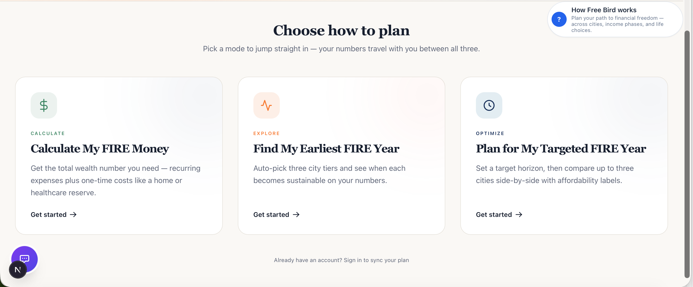
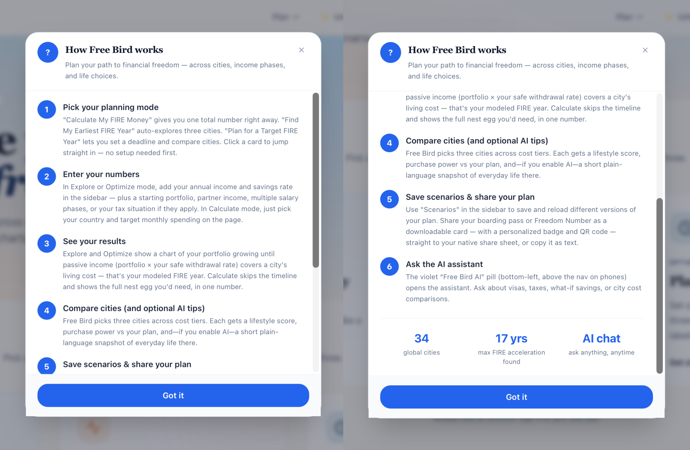

### Calculate My FIRE Money

This is the **one-number** mode: it does not project a timeline or compare cities. You say how you want to live in FIRE; Free Bird returns the nest egg that supports that lifestyle.

- Pick your **country** (currency and default inflation follow automatically) and your **desired monthly spending in FIRE**.
- One plain-language sentence explains the math — safe withdrawal rate minus inflation — instead of sliders to tune.
- Add **one-time costs**: a home purchase, a lifetime healthcare reserve, children (extra kids cost a bit less each, not a straight multiply), or your own custom line items.
- Tap **Calculate** to turn your total into a **shareable Freedom Number card** — with a personalized badge (e.g. "The House-First Planner"), a QR code, and one tap to download or post it straight to social.

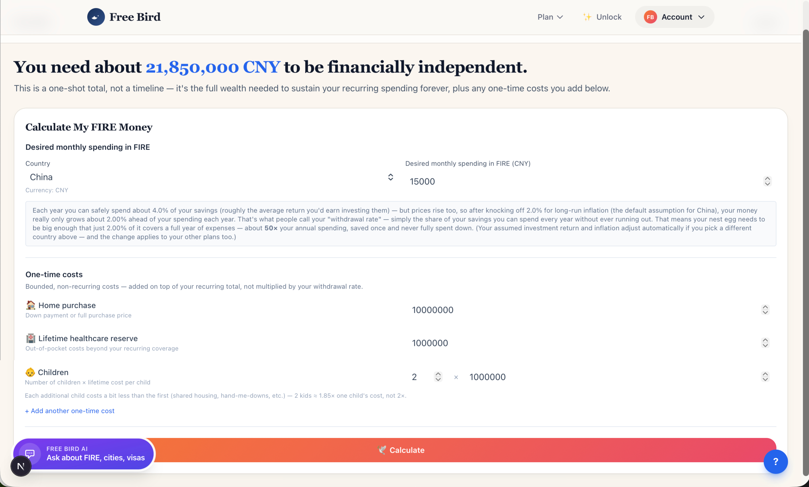
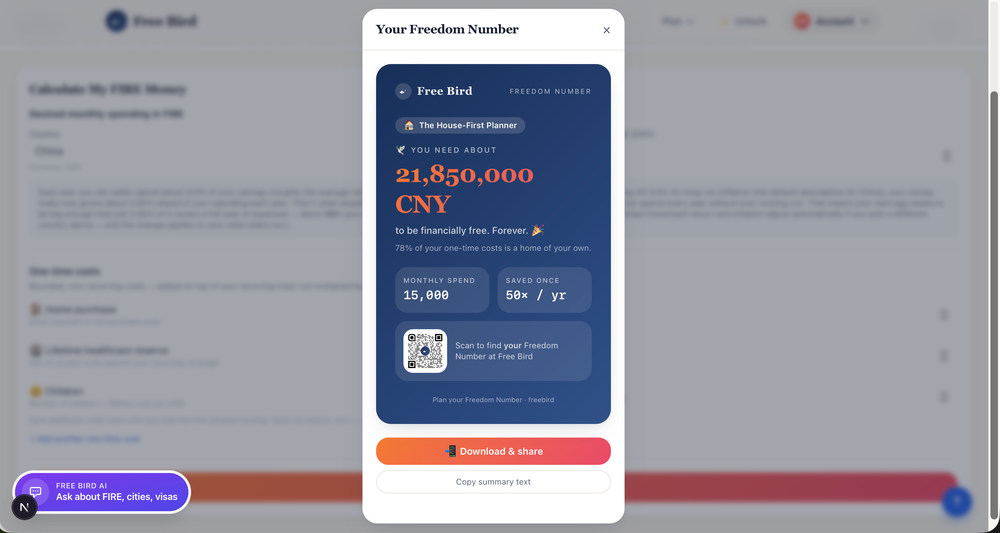

### Find My Earliest FIRE

This is the **when** mode: you don’t pick a date. Free Bird finds the **soonest year** your plan could cover real city living—and how much cheaper or pricier places move that date.

- **Tell us your numbers**: a three-column step for **Your Plan Inputs**, **Income Phases** (raises or part-time stretches, each with an editable month count), and **How You Save & Invest** (savings vs. spend, then a 3-way split of how those savings are invested).

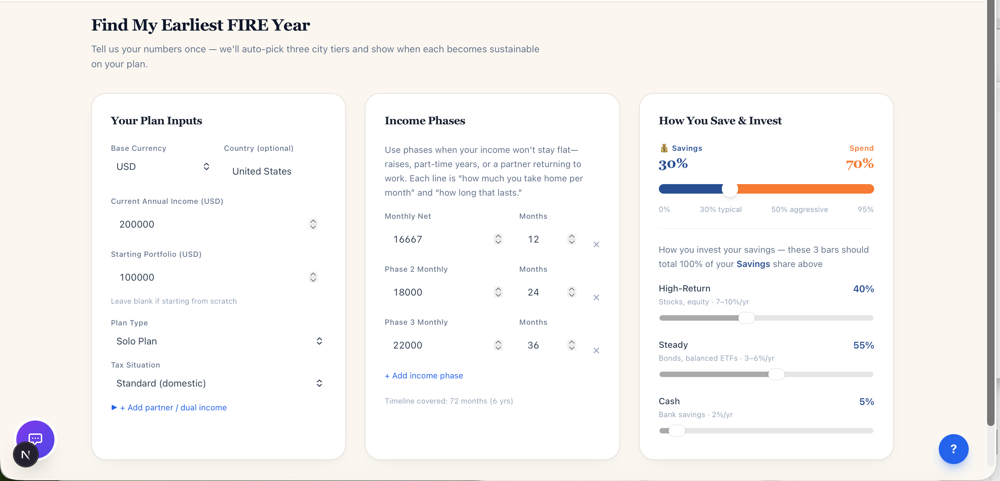

- **Projection chart**: portfolio vs. passive income (using your **safe withdrawal rate**).

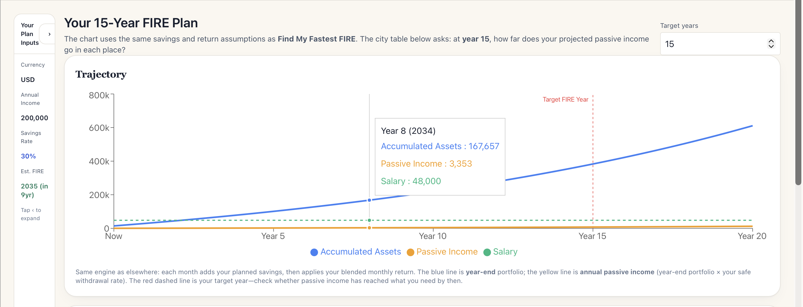

- **Three city tiers** (lower / mid / higher cost) are auto-picked, with lifestyle scores, purchase power, and optional AI “feel” copy—**geo-arbitrage aware** (cheaper cities can rank higher for quality at your asset level).

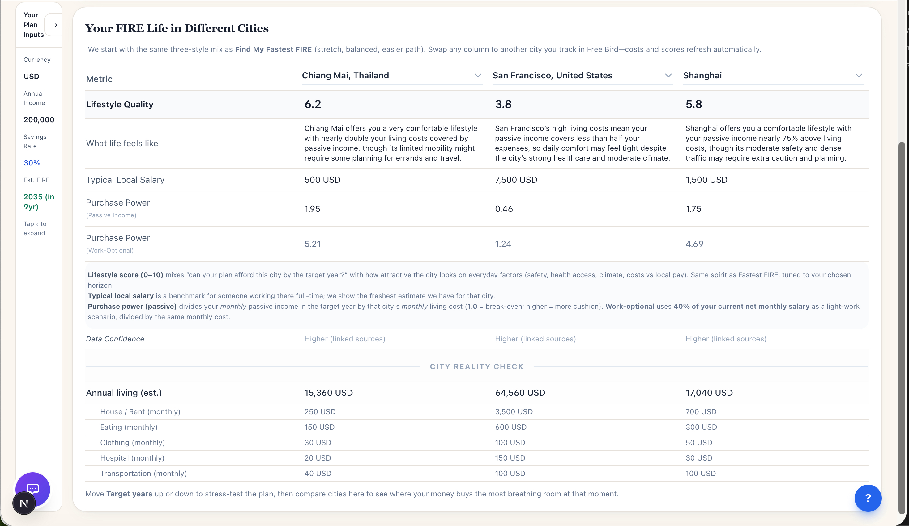

- **Save scenarios & share** as a boarding pass card—download, native share sheet, or copy as text.

### Plan for a Target Year

This is the **by-this-year** mode: the date is fixed; the question is **where**. Same calculation logic as Find My Earliest FIRE, but **not the same numbers**—each run is its own plan.

- Same **three-column inputs** as above—enter this mode’s own income, phases, and savings mix.
- Set a **target horizon in years**; the chart marks that year.
- Compare **up to three cities** you choose, with cost breakdowns, lifestyle scores, and **personal affordability** labels (e.g. safe / balanced / stretch).
- **Save scenarios & share** a boarding pass card, same as above.

### My Account

- **Single dashboard** — profile (email, sign in / out), **FIRE snapshot** stats from your saved plan, and collapsible **settings** (currency, clear saved cards). **Pro** status appears here too, with **Upgrade** to Free Bird Pro.

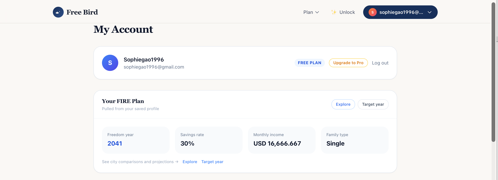

- **My Cards** — turn your plan into a **shareable snapshot of your money personality**: a Freedom Boarding Pass, a "Ghost of Future Past" narrative + AI art portrait, and a Global Citizen Passport — each built to show off who you are as a planner (disciplined saver, city-hopping optimizer, slow-and-steady builder…) in a format that's made for Stories and feeds, not a spreadsheet.

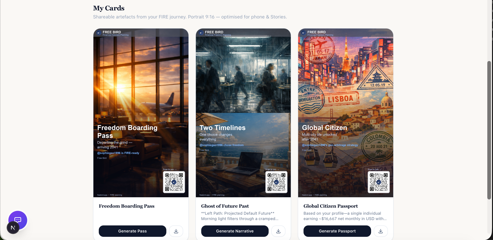

### Unlock

- **Free Bird Pro** — unlimited cities, multi-stage life paths (career breaks, sabbaticals, partner phases, kids), unlimited AI Coach, and premium momentum cards, at a single $9/month plan.
- When you’re signed in, **Upgrade** starts checkout. Success returns you to **My Account**.

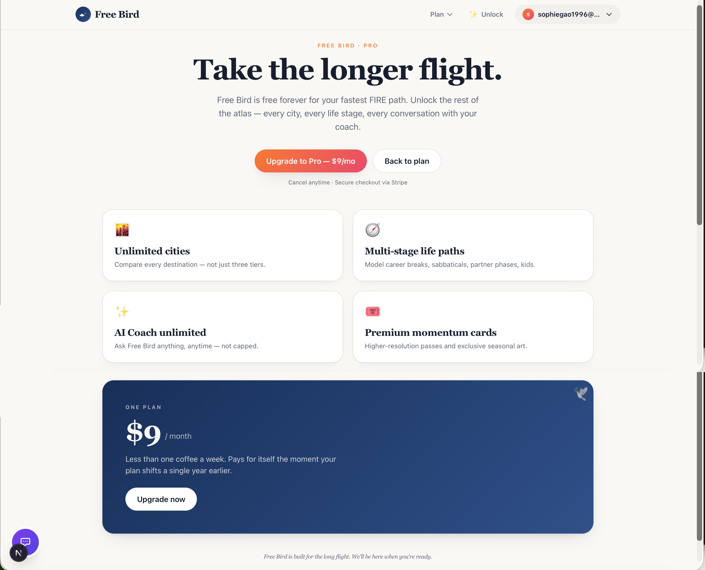

### Everywhere

- **Free Bird AI** (round button, bottom-left on every page): tap to open a chat with your **plan** in context—ask about visas, taxes, city life, or "what if" savings scenarios.
- **User guide** (collapsible panel on the planning screens): a short walkthrough for the screen you're on.
- **"Deepen your plan?"** — after you calculate, an optional prompt reflects your plan's personality back to you and offers a **Comfort** or **Momentum** variation—so you weigh richer experiences against pure savings, not just the numbers.
- **Navigation** (top-right, every page) — **EN | 中文** for language, then **Plan**, **Unlock**, and **Account**.

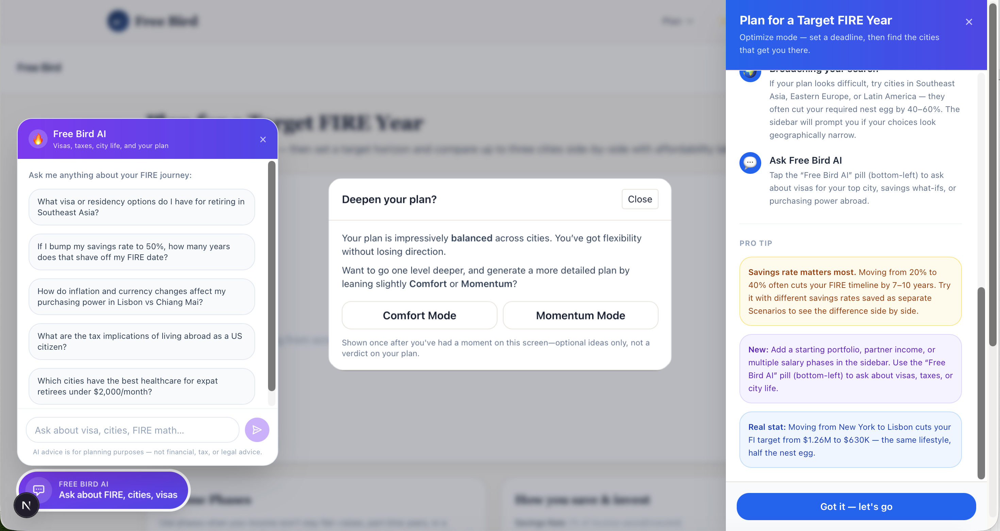
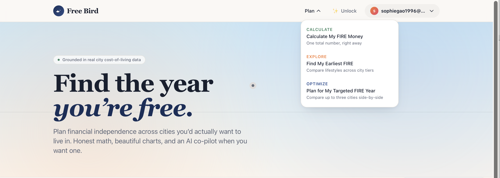
